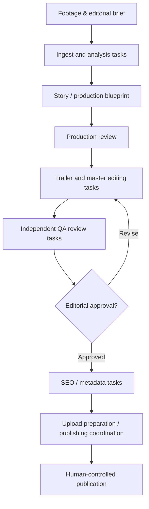

# AI-assisted Video Production — Claude Code Multi-Agent Case Study

**Technology:** Claude Code · Task delegation · Multi-agent workflows · Editorial QA · Metadata preparation

> **Evidence status (23 November 2026):** This repository documents **observed Claude Code agent task orchestration** during a real YouTube content-production workflow. It does **not** claim that a fully unattended, continuously running, 11-agent video-editing system has been deployed.

## The problem

Preparing a YouTube video can involve several distinct activities: reviewing source footage, planning a narrative, assembling an edit, reviewing trailers and master cuts, preparing platform metadata, and coordinating publication. I explored distributing parts of this workflow to specialised AI tasks, with human judgement retained for editorial decisions and publication.

## What the Claude Code activity records show

Inspection of local Claude Code project history for a YouTube production folder showed:

| Recorded item | Count | Interpretation |
| --- | ---: | --- |
| Subagent session log files | **19** | Recorded subagent sessions, not 19 unique agent definitions |
| `general-purpose` agent invocations | **24** | Task/Agent tool-use entries matching this agent type |
| `web-fetch` agent invocations | **2** | Task/Agent tool-use entries matching this agent type |
| `head-of-production` agent invocations | **1** | Task/Agent tool-use entry matching this agent type |
| **Total matching agent invocations** | **27** | Not a count of unique agents or completed deliverables |

**Evidence source:** local Claude Code session metadata and task descriptions, inspected via a read-only command. The raw session logs, conversation content, credentials, and private production files are **not** published.

The distinction is important: **19 session files**, **27 recorded tool-use entries**, and **3 observed agent-type names** measure different things. A task description indicates an attempted or requested handoff, **not** proof that editing, upload, or any other action completed successfully.

## Observed task categories

The inspected task descriptions include requests corresponding to these workflow areas:

1. **Ingest and planning** — source analysis and an editorial blueprint for a travel video.
2. **Production oversight** — review of the production blueprint and final-cut quality checks.
3. **Trailer editing** — trailer edits and revision iterations.
4. **Independent quality assurance** — separate review requests for trailer and master outputs.
5. **SEO and metadata** — metadata creation and publication-package review.
6. **Platform coordination** — requests relating to private YouTube upload preparation and Instagram trailer versions.
7. **Reference research** — consultation of official metadata and automation guidance.

The wording above is a **categorisation of recorded tasks**, not a reproduction of private logs or a verified list of finished outputs.

## Workflow architecture

The diagram below is a **conceptual summary of the observed task types**. It is not an exported execution graph.

The approval decision and overall sequence express the **intended operating model**. They have not been independently validated as enforced application logic.

## Planned design vs verified implementation

Earlier design discussions envisioned a team of **11 specialised roles** for the broader video workflow. The logs inspected so far explicitly identify **three agent-type names** (`general-purpose`, `web-fetch`, `head-of-production`). The available evidence does not establish that eleven distinct custom-agent configuration files existed or that all proposed roles were operational.

A future engineering phase could turn the observed task handoffs into a reproducible system with:

- Explicit, version-controlled role definitions
- Structured task inputs and output artifacts
- File-based state transitions and retry handling
- Privacy and secrets management
- Human approval gates before publishing
- Integration tests and auditable execution logs

**These are proposed improvements, not existing features proven by this case study.**

## Engineering lessons

- A task delegation system needs **clear handoff contracts** to avoid circular reviews and duplicated work.
- Separate **editorial work** from **independent QA**, then require a review decision.
- Treat platform upload as a privileged step; keep credentials out of repositories.
- Distinguish **requested actions**, **tool invocations**, and **verified outcomes**.
- Write case studies from verifiable evidence, rather than equating the number of logs with the number of agents.

## Privacy and provenance

This project is an **evidence-based technical case study**, not a runnable software release. It intentionally excludes:

- Raw `.jsonl` transcripts or assistant conversation histories
- OAuth tokens, environment files, connected accounts and settings
- Private footage, drafts, channel details and publication credentials

No time savings, revenue uplift, automated publishing success, or unattended end-to-end deployment is claimed.

**Portfolio:** [AI-assisted video production workflow](../../projects/ai-production-workflow.html)
