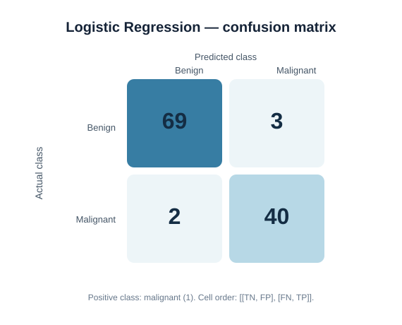
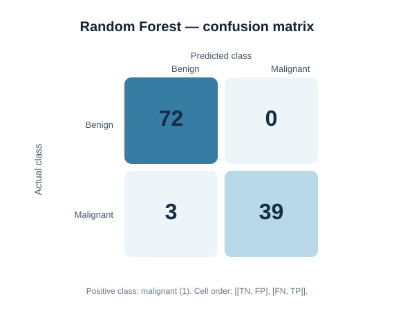

# Breast Cancer Classification — Python Machine Learning

**MSc Data Science | Applied Machine Learning and Deep Learning (MS4S16) | University of South Wales, 2026**

A reproducible binary-classification project based on my university assessment. It compares **Logistic Regression** and **Random Forest** on a modified Wisconsin Breast Cancer dataset, and includes exploratory PCA/K-Means analysis in the original notebook. The goal is to demonstrate cleaning, modelling, error analysis and evaluation rather than build a clinical decision tool.

> **Medical disclaimer:** Academic demonstration only. Do not use predictions to diagnose disease or make patient-care decisions.

## What the project demonstrates

- Data exploration, missing-value checks, including `-999` sentinels, and handling of duplicate rows
- Stratified 80/20 train/test split (random state 42)
- A data-leakage-safe preprocessing pipeline with `SimpleImputer` fit on the training set only
- Feature scaling for Logistic Regression and a non-scaled Random Forest baseline
- Evaluation by accuracy, precision, recall, F1-score, **ROC-AUC** and confusion matrices
- Particular attention to malignant-class **false negatives**

## Results

The numbers below were **recomputed by running the published `train_and_evaluate.py` script** on the supplied dataset. They differ from the original assessment where applicable because the revised pipeline removes duplicated rows and avoids fitting the missing-value imputation on the full dataset. It also treats `-999` sentinel values as missing rather than physical measurements.

| Model | Accuracy | Malignant recall | ROC-AUC | False negatives |
| --- | ---: | ---: | ---: | ---: |
| Logistic Regression | **95.61%** | 95.24% | 0.9838 | 2 |
| Random Forest | **97.37%** | 92.86% | 0.9964 | 3 |

The saved outputs in the **original university notebook** recorded **95.61%** for Logistic Regression and **98.25%** for Random Forest. These two sets of results should **not** be treated as the same experiment. The original notebook filled missing feature values before the train/test split, which risks information leakage; it also did not remove duplicate records before splitting or explicitly handle the `-999` missing-value markers.

The revised evaluation uses one held-out split. These are **not cross-validated estimates**, and no external clinical validation was performed. The Random Forest's higher accuracy did not mean fewer false negatives in the revised run.

## Confusion matrices





## Files

```text
research/breast-cancer-classification/
├── README.md
├── data/
│   └── MS4S16_Dataset.csv              # Supplied course dataset, 571 rows
├── notebooks/
│   ├── reproducible_classification.ipynb   # New notebook (verified execution)
│   └── original_assessment_source.ipynb    # Original 58-cell source, outputs removed
├── scripts/
│   └── train_and_evaluate.py           # Rerunnable evaluation
├── results/
│   ├── model_comparison.csv
│   └── evaluation_details.json
├── figures/
│   ├── logistic_regression_confusion_matrix.svg
│   └── random_forest_confusion_matrix.svg
└── requirements.txt
```

## Run the analysis locally

Requires **Python 3.10+**. Download or clone this repository and change into this project's folder:

```bash
git clone https://github.com/mrcdmn03/mrcdmn03.github.io.git
cd mrcdmn03.github.io/research/breast-cancer-classification
python3 -m venv .venv
source .venv/bin/activate
python -m pip install -r requirements.txt
python scripts/train_and_evaluate.py
```

On Windows, use `.venv\Scripts\activate` instead of `source .venv/bin/activate`.

The script writes the evaluation CSV, detailed class metrics and figure PNGs into `results/` and `figures/`. To open the executed notebook, run:

```bash
jupyter notebook notebooks/reproducible_classification.ipynb
```

The notebook expects to be launched from the project root, as shown. It was executed successfully in Python using `nbclient` before publication.

## Data and preprocessing

- Supplied dataset: **571 rows**, 32 columns (ID, diagnosis, 30 numerical predictor features)
- Target counts before cleaning: 356 benign, 212 malignant, 3 missing diagnoses
- After removing rows with missing diagnosis and exact duplicate rows: **566 rows** (355 benign, 211 malignant)
- ID is excluded from model training. The dataset has `-999` sentinels in some numeric features; these values are converted to missing and imputed with **training-set means only**. After cleaning, there are **261 missing numeric feature cells** including sentinels.
- Rows are split with `stratify=y`, `random_state=42`.

This is the course-supplied, modified Wisconsin Breast Cancer dataset. Original feature measurements originate from the Wisconsin Diagnostic Breast Cancer data family. **The academic dataset's redistribution rights should be checked against the University's course terms before reuse outside this portfolio.** Do not assume this repository grants a licence to the underlying source data.

## Original assessment and improvements

- `notebooks/original_assessment_source.ipynb` contains the **actual assessment source cells**. Only cached execution results and notebook environment metadata were stripped to reduce size and avoid exposing local machine paths.
- `notebooks/reproducible_classification.ipynb` is an independently tested follow-up demonstrating corrected split/preprocessing order.
- The original assessment also explored PCA and K-Means clustering; those exploratory results are preserved in the source notebook, not claimed as independently reproduced in the revised evaluation.

## Limitations

A single hold-out dataset and one random split do not establish medical reliability or generalisability. Class imbalance, possible sampling effects, false negatives, and data provenance all matter. This work was completed for an academic module and is not intended for clinical deployment.

## Author

Mirac Duman — [LinkedIn](https://www.linkedin.com/in/miracduman/) · [Portfolio](https://mrcdmn03.github.io/)