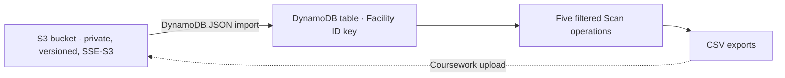

# EcoStream Energy — AWS Data Engineering & Telemetry Validation

**MSc Data Science · Big Data Engineering and its Applications (MS4S21) · University of South Wales**

A practical cloud-data coursework case study covering **Amazon S3**, **Amazon
DynamoDB**, **filtered NoSQL scans**, **CSV validation**, **AWS VPC networking**,
**EC2 web deployment**, and **Amazon Machine Image (AMI)** creation. The original
lab was carried out using the AWS Console and documented with practical
step-by-step reports. This repository combines the verified coursework record
with a new, **locally runnable Python recreation** of its five DynamoDB
telemetry filters.

## What I implemented during coursework

- Created an **S3** bucket with public-access blocking, versioning and SSE-S3 encryption.
- Imported a 100-record **DynamoDB JSON** dataset from S3 into DynamoDB, using a
  string `Facility ID` partition key and on-demand capacity.
- Ran five filtered **DynamoDB Scan** operations, exported the results as CSV,
  and uploaded the exports to S3.
- Set up a custom **VPC** with one public subnet, two private subnets and an
  Internet Gateway; deployed an Apache web page on an Amazon Linux EC2 instance.
- Created a reusable **custom AMI** from an Ubuntu instance with Node.js and
  launched a validation EC2 instance from it.

For networking and cloud-service configuration, see
[architecture and implementation notes](docs/architecture.md).

## Architecture



## Five query/quality-control tasks

| Task | Filter | Original coursework results (100 records) |
| --- | --- | ---: |
| Newly recorded maintenance incident | `Incidents 2024 = 0 AND Incidents 2025 >= 1` | **11** |
| Lower 2025 output | `Output 2025 < 50,000 MWh` | **23** |
| High-performance wind facilities | `Type = Wind AND Tier = High-Performance` | **18** |
| Sustained high energy output | `Output 2024 > 100,000 AND Output 2025 > 100,000 MWh` | **35** |
| Impossible 2024 downtime | `Downtime Hours 2024 > 8,784` | **1** |

The final rule is a **data-quality check**, because 2024 had 8,784 hours in total.
Original counts were checked against the supplied 100-record dataset. See
[coursework result details](docs/coursework-results.md).

## Run the local demonstration

**Requirements:** Python **3.10+**; no external packages, credentials,
cloud resources or network connection needed.

From the project folder:

```bash
python3 scripts/generate_synthetic.py
python3 scripts/run_queries.py
python3 -m unittest discover -s tests -v
```

Generated CSV results are written to `results/generated/`.
The test script checks all five filters, CSV columns, the anomaly detection,
the DynamoDB JSON reader and duplicate partition keys.

### Optional: read from an existing AWS DynamoDB table

An additional **read-only AWS Scan example** is provided in
[`scripts/aws_readonly_scans.py`](scripts/aws_readonly_scans.py).
It does not create or modify AWS resources and **has not been tested against a
live AWS account** in this environment.

```bash
python3 -m pip install -r requirements-aws.txt
python3 scripts/aws_readonly_scans.py --table YOUR_EXISTING_TABLE --region us-east-1
```

You must already have your own authorised table and AWS credentials configured
through the standard AWS credential chain. AWS requests can incur charges.
Do not commit keys, tokens, account details or private source data.

## Project files

| Path | Purpose |
| --- | --- |
| `data/synthetic_telemetry.jsonl` | Fictional DynamoDB-format test input |
| `scripts/generate_synthetic.py` | Deterministic synthetic sample-data generator |
| `scripts/run_queries.py` | Runnable local copy of the five filter conditions |
| `scripts/aws_readonly_scans.py` | Optional boto3 server-side Scan example |
| `results/sample_summary.json` | Expected counts for the **synthetic** sample |
| `tests/test_queries.py` | Automated offline tests |
| `docs/architecture.md` | Source-backed AWS lab architecture and implementation |
| `docs/coursework-results.md` | Verified counts from the original coursework |

## Source provenance and limitations

The underlying EcoStream coursework documents were prepared for **MS4S21
Practical Coursework 2**. The original practical used the **AWS Management
Console**; the Python scripts and automated tests in this repository are a
**separately authored portfolio demonstration**, not code submitted as the
original assignment. They reproduce the documented filter logic using safe,
fictional facility data.

The source AWS JSON data, original CSV exports, cloud-console screenshots,
private keys and academic teaching materials have **not** been uploaded.
The original dataset was supplied for coursework and no public redistribution
permission was established. Infrastructure is documented from the completed
lab, **not maintained as a running cloud service**. The offline sample and tests
have been executed; the optional boto3 AWS script and live AWS environment have
**not** been independently exercised here.
