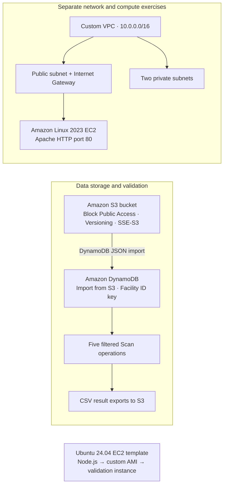

# Coursework architecture and implementation notes

This architectural outline is based on my Big Data Engineering & Applications
(MS4S21) practical coursework for the fictional EcoStream Energy organisation.
The AWS infrastructure was configured through the **AWS Academy / AWS Console**;
it is **not** currently deployed by this repository.

## S3 configuration described in the coursework

- Bucket set to **Block all public access**.
- Bucket versioning **enabled**.
- Default encryption with **SSE-S3**.
- DynamoDB JSON file uploaded for **DynamoDB Import from S3**.
- Five CSV query-result files subsequently uploaded to S3.

## DynamoDB workflow

- Dataset model: facilities as DynamoDB JSON items with a string `Facility ID` partition key.
- Original provided dataset: 100 facilities.
- Imported into DynamoDB using **Import from S3**, with on-demand capacity.
- Five exercises performed using filtered **Scan** operations. These are not
  partition-key-based DynamoDB Query operations.
- Exported CSV outputs were reviewed as part of the coursework.

## Network / EC2 exercise

- Region used in coursework: `us-east-1`.
- Custom VPC CIDR: `10.0.0.0/16`.
- One public subnet, two private subnets, an Internet Gateway, and route tables.
- NAT Gateway and VPC endpoints omitted for the assignment's limited scope.
- Amazon Linux 2023 on a small EC2 instance with an Apache HTTP page reachable over port 80.
- Separate Ubuntu 24.04 template instance used to install Node.js, create a custom AMI,
  and verify the image using another EC2 instance.

**Security / reproducibility:** Original screenshots of an authenticated AWS
console, account-specific resource IDs, SSH material and credentials are not
published. The implementation notes reflect the completed lab, not a claim
that a live service is available today. Running AWS services may incur charges.
