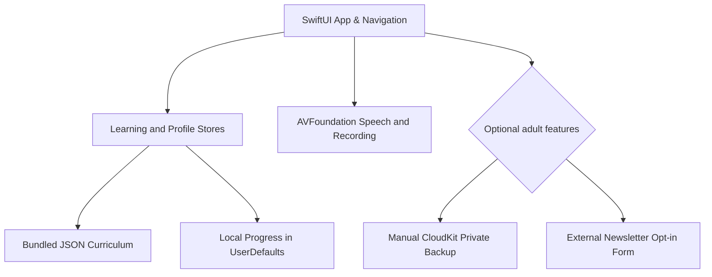

# Lingo Isles — iOS English Learning App
**Portfolio case study | SwiftUI • Offline Learning • CloudKit • AVFoundation • Privacy-conscious product design**

> **Source review:** Lingo Isles v6.3.2 Xcode source snapshot, reviewed 23 November 2026. This is a development/testing candidate, not evidence of an App Store release.

Lingo Isles is a mobile English-learning experience organised around daily practice, an island-based learning journey and self-directed activities. The product combines short lessons with a visual progression system to encourage consistency, without making an external AI service a prerequisite for learning.

## What I developed
- **Native iOS product:** SwiftUI navigation, animated feedback and a consistent green/blue visual identity.
- **Structured learning curriculum:** Six themed islands and 60 lesson records in the bundled curriculum.
- **Skill-based practice:** Grammar, vocabulary and listening activities, plus a daily coach and quick mixed practice.
- **Adventure and motivation:** Interactive stories, 12 branching missions, an island builder with unlockable places, progress rewards, XP and streaks.
- **Local-first experience:** Bundled content and locally saved progress for lessons usable without an account or network connection.
- **Audio learning:** AVFoundation-based speech playback and on-device voice recording/playback in the pronunciation activity.
- **Optional private backups:** CloudKit private-database functionality with user-initiated save, restore and deletion controls; native-device verification is pending for this source snapshot.
- **Optional adult newsletter signup:** An external HTTPS marketing form; not required for learning, and the source explicitly restricts the offer to adult profiles.

### Implementation details verified in source
| Component | Source evidence |
| --- | --- |
| App entry | `LingoIslesApp.swift`, profile-led SwiftUI onboarding |
| Curriculum | `curriculum.json`: 6 islands / 60 lessons |
| Grammar | `grammar_v6.json`: 36 grammar entries |
| Vocabulary | `mastery_v6.json`: 838 vocabulary records / 72 groups |
| Listening | `mastery_v6.json`: 64 listening items in that particular resource |
| Narrative content | `adventure_v6.json`: 18 stories / 12 missions |
| Offline persistence | `LearningStore.swift`, `UserDefaults` |
| Optional backup | `ICloudBackup.swift`, CloudKit |
| Audio | `PronunciationStudioView.swift`, AVFoundation |

These are **source-file counts**, not certified CEFR levels, user results, app analytics or claims that every feature was independently tested on an iPhone.

## Technical design

The core learning interface does not require a login or external AI model. Cloud backup and external signup are optional extensions, so **"offline learning" does not mean the app has no internet-related features**.

## Testing and release status
The supplied source includes regression scripts, Swift test sources and a historical test-results document. Static/source checks were recorded for earlier versions. The v6.3.2 integration report explicitly states that **native Xcode compilation, device runtime, CloudKit production configuration and live email opt-in were not verified** in that report.

Accordingly, this portfolio does **not** claim the app is live on the App Store or that the v6.3.2 cloud/marketing integration has passed end-to-end testing.

## Screens and product design
Five promotional screenshots were supplied for the portfolio review: Home, Learning Path, Practice, Adventure and Island Builder. The design uses floating islands, a bright visual palette and card-based learning controls.

## Source disclosure
The original Xcode project is a **commercial/proprietary work-in-progress** and is not included in this public repository. Bundled instructional content, build credentials, service configuration, end-user information and cloud integrations are intentionally excluded. This README documents implementation decisions without redistributing the complete source.

**Skills shown:** SwiftUI · iOS architecture · offline-first data design · JSON content modelling · state management · gamification · optional cloud backup · accessibility considerations · test planning · AI-assisted software development.

**AI disclosure:** AI tools supported parts of the development workflow. The app itself does not rely on an AI conversational service to deliver its core lessons.
