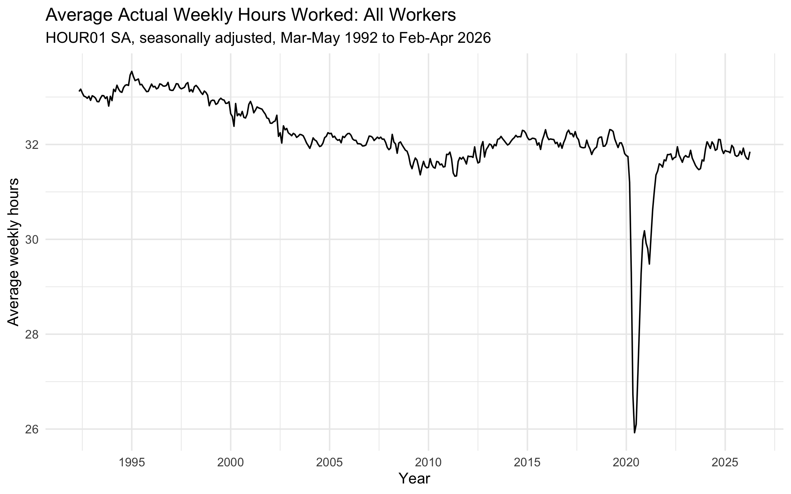
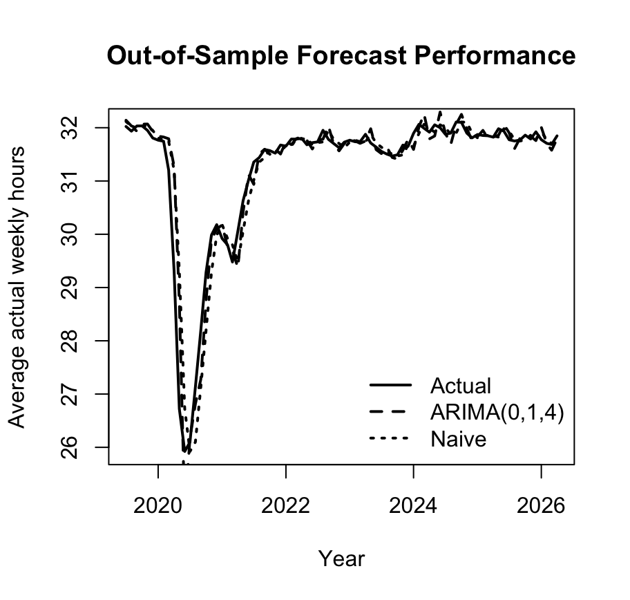
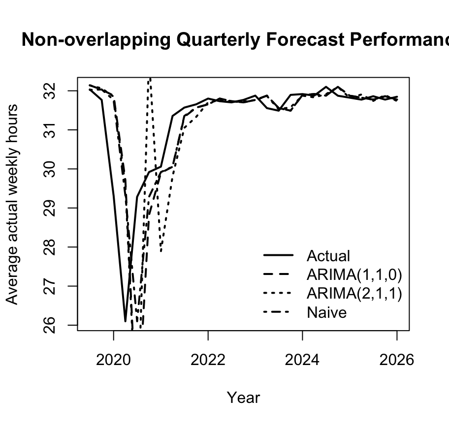

# UK Working Hours Forecasting — ARIMA vs Naïve Models

**MSc Data Science dissertation | University of South Wales | 2026**

An empirical time-series project examining UK average actual weekly hours worked using data from the **Office for National Statistics (ONS)**. The analysis compares ARIMA and naïve forecasting, examines COVID-affected periods, and tests how overlapping monthly estimates differ from non-overlapping quarterly observations.

## Research question

How accurately can ARIMA models forecast UK average actual weekly hours worked, and how sensitive are the results to data structure and economic disruption?

## Data and methodology

- **408 observations**, from **March–May 1992 to February–April 2026**, in the seasonally adjusted **ONS HOUR01** series.
- **326 observations for initial training** and **82 for out-of-sample evaluation**.
- Stationarity assessment using **Augmented Dickey–Fuller (ADF)** and **KPSS** tests, with ACF/PACF diagnostics.
- Candidate ARIMA models compared using **AICc**, **BIC**, residual diagnostics and rolling/expanding-window one-step-ahead forecasts.
- Performance evaluated using **MAE, RMSE, MAPE and MASE**.
- Sensitivity checks using **non-overlapping quarterly data**, alongside COVID-affected subperiod analysis.
- Original analysis produced a **12-period forecast** with 80% and 95% prediction intervals.

## Selected results

Reported results from `tables/final_model_comparison_accuracy.csv`:

| Series / evaluation | Model | MAE | RMSE | MAPE | MASE |
| --- | --- | ---: | ---: | ---: | ---: |
| Overlapping monthly | ARIMA(0,1,4) | 0.194 | **0.392** | 0.655 | 2.643 |
| Overlapping monthly | Naïve | 0.221 | 0.455 | 0.752 | 3.009 |
| Non-overlapping quarterly | ARIMA(1,1,0) | 0.642 | 1.454 | 2.205 | 4.942 |
| Non-overlapping quarterly | Naïve | **0.502** | **1.039** | **1.726** | **3.870** |

**Interpretation:** ARIMA(0,1,4) outperformed naïve forecasting on the original overlapping monthly evaluation, but this advantage did **not** persist in the non-overlapping quarterly sensitivity analysis. The original analysis also found variation across pre-COVID, COVID-affected and post-COVID periods. These differences matter when interpreting forecasting performance.

## Visual outputs







## Repository structure

```
.
├── data_raw/                 # Original June 2026 ONS Excel releases used by the scripts
├── data_clean/               # Original project CSV exports
├── scripts/
│   ├── 01_data_loading_cleaning.R
│   └── 02_stationarity_analysis.R
├── tables/                   # Original model comparison and forecast results
├── figures/                  # Selected original charts and diagnostics
├── setup_packages.R          # Dependency installation
├── run_all.R                 # Run analysis in sequence
└── MSc_Working_Hours_Forecasting.Rproj
```

## How to run locally

1. Install **R** and, optionally, **RStudio**.
2. Download this project folder (or clone the containing repository). Work from this project's own directory, not the portfolio website's root.
3. Open `MSc_Working_Hours_Forecasting.Rproj`, or open a terminal in the project directory.
4. Install the R packages with:

   ```r
   source("setup_packages.R")
   ```

5. Run both scripts in order:

   ```r
   source("run_all.R")
   ```

Or use the command line from the same directory:

```bash
Rscript setup_packages.R
Rscript run_all.R
```

The second script includes computationally intensive ARIMA model searches and expanding-window re-estimation. Outputs may depend on local R/package versions.

### Reproducibility status

These are **real project scripts and original project outputs**, not fabricated demonstration code. I removed automatic package installation and RStudio-only `View()` calls from the first script for a cleaner non-interactive workflow; the forecasting script is preserved from the supplied project. The CSV result tables and figures are original artefacts. **A full re-execution has not been independently verified in this publishing environment**, because R was not available. The included run script is a convenience wrapper, not a claim of successful end-to-end testing.

## Dataset source and attribution

- [ONS HOUR01 SA: Actual weekly hours worked (seasonally adjusted)](https://www.ons.gov.uk/employmentandlabourmarket/peopleinwork/earningsandworkinghours/datasets/actualweeklyhoursworkedseasonallyadjustedhour01sa)
- [ONS HOUR01 NSA: Actual weekly hours worked (not seasonally adjusted)](https://www.ons.gov.uk/employmentandlabourmarket/peopleinwork/earningsandworkinghours/datasets/actualweeklyhoursworkednotseasonallyadjustedhour01nsa)
- The `data_raw/` folder contains the **June 2026** workbook versions included in the original MSc submission. Newer versions on the ONS website may differ due to later revisions.

**Source: Office for National Statistics, licensed under the Open Government Licence v3.0.** The ONS dataset licence does not automatically license the author's R scripts for redistribution or reuse.

## Notes

This is academic forecasting, not an operational forecasting service. COVID-19 and the use of overlapping rolling three-month estimates complicate evaluation. The provided metric values are taken from saved project outputs; they have not been independently recalculated here.