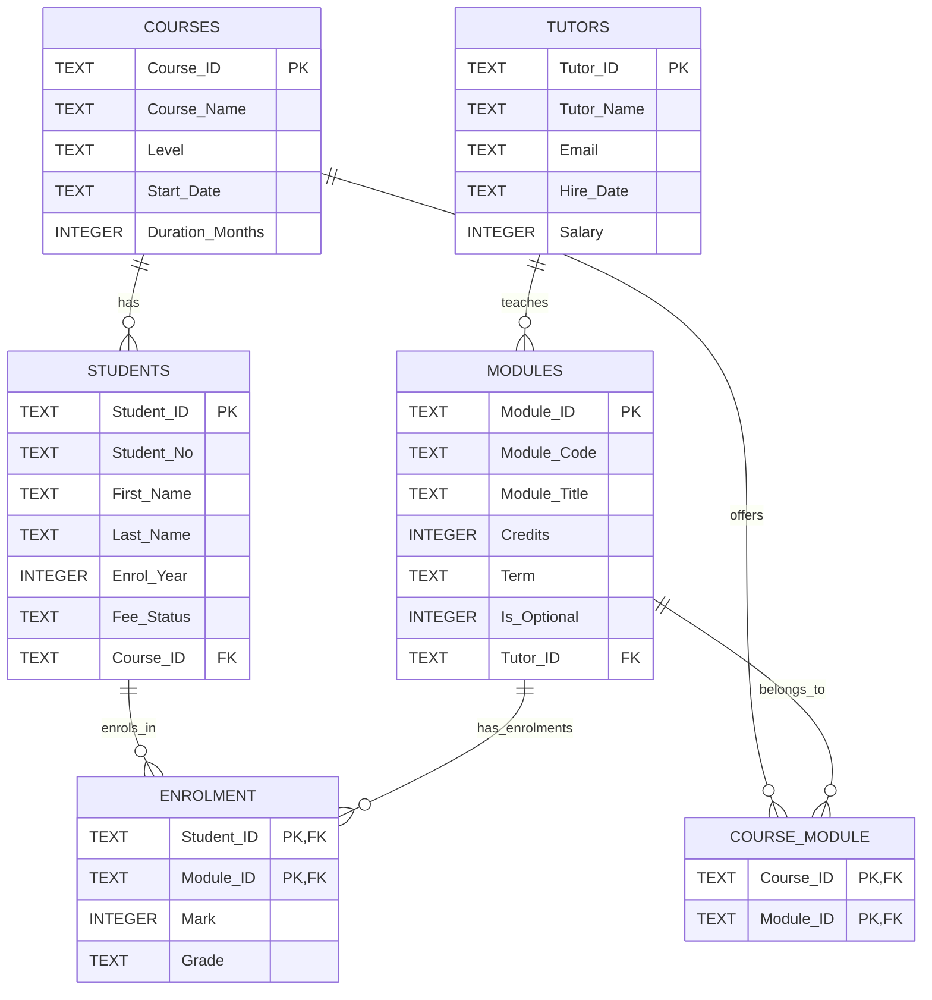

# University Department Database — SQL & Data Modelling

**Principles of Computing (IS4S761) | MSc Data Science coursework | 2025**

An academic project covering **relational database design**, **primary and foreign keys**, **many-to-many relationships**, **referential integrity**, and **SQL reporting**. Adapted from my coursework submission for a fictional university computing department.

## What I built
Six related tables: Courses, Tutors, Modules, Students, Course_Module and Enrolment, with composite keys and an optional-module CHECK constraint. The database models courses, student enrolments, tutor assignments and student grades. Five reporting queries answer business questions about course sizes, module performance, teaching workload, shared modules and unfilled optional modules.

## Database design and ER diagram

This database was developed for a fictional university department as part of my Principles of Computing coursework. The diagram reflects the table and column names in the published SQLite schema, adapted from the original Oracle SQL assignment.



### Relationships and integrity

- **COURSES → STUDENTS:** Each student belongs to one course; each course can have multiple students.
- **TUTORS → MODULES:** Each module is assigned to one tutor; a tutor can teach multiple modules.
- **COURSES ↔ MODULES:** `COURSE_MODULE` links courses and modules through a many-to-many relationship.
- **STUDENTS ↔ MODULES:** `ENROLMENT` links students and modules, with optional `Mark` and `Grade` values for each enrolment.

Both `COURSE_MODULE` and `ENROLMENT` use **composite primary keys** made up of their two foreign-key columns. Foreign-key constraints maintain referential integrity. The `MODULES.Is_Optional` field is restricted to `0` or `1` by a `CHECK` constraint.

For executable definitions and constraints, see [`sql/01_schema.sql`](sql/01_schema.sql). The repository uses anonymised, fictional sample records.

## Run the project

Python 3.10+ is enough: **no database server or external packages** are required.

From the portfolio repository root:

```bash
python3 research/university-database-sql/run_queries.py
python3 -m unittest discover -s research/university-database-sql/tests -v
```

Or, if this project was downloaded separately, run `python3 run_queries.py` and `python3 -m unittest discover -s tests -v` from this folder.

## Files

- `sql/01_schema.sql` — schema, keys and integrity constraints
- `sql/02_seed.sql` — anonymised, fictional sample records
- `sql/03_analysis_queries.sql` — five analytical queries extracted from the coursework
- `run_queries.py` — runnable SQLite demonstration
- `tests/test_database.py` — automated checks of key constraints and selected results
- `sample_results.json` — sample query output

## Selected outputs
- **Computer Science:** 4 enrolled students; Cyber Security and ICT: 3 each.
- **Database Systems:** 10 enrolled, 9 graded; average mark approximately **64.78**.
- **Big Data Analytics (BDA707):** optional module with no enrolments.

## Technical provenance
The coursework report originally used Oracle SQL, including `VARCHAR2`, `NUMBER` and `TO_DATE`. The SQL files in this repository are **adapted for SQLite portability**, not a claim that SQLite was used during the original assignment. All sample staff and student names, email addresses and identifying student numbers were replaced. The Python runner, automated tests and README were added during portfolio preparation.

University lecture slides, instructor solutions and the original assessment brief have **not** been published. This is a teaching case study, not a real university database.
